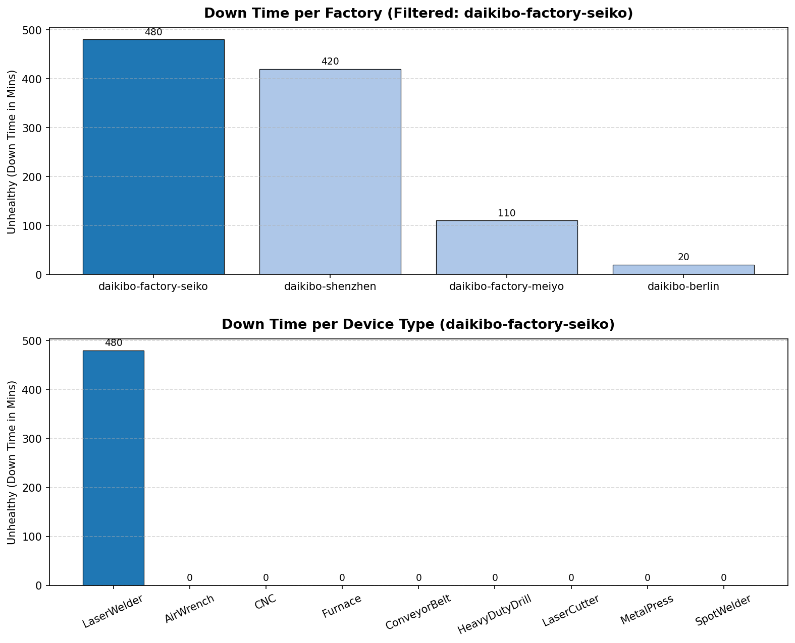

# Deloitte Australia Data Analytics Job Simulation

## Project Overview
Completed a two-part data analytics and forensic technology simulation analyzing industrial IoT telemetry logs and employee compensation parity for Daikibo Industrials.

## Key Tasks & Findings
### 1. Industrial Telemetry Downtime Analysis
- **Objective:** Identify which manufacturing facility experienced the highest machine downtime and which equipment types drove the failures.
- **Tools:** Python (Pandas, Matplotlib), Tableau
- **Key Insight:** **daikibo-shenzhen** recorded the highest total downtime, allowing maintenance teams to target specific high-failure device types.

### 2. Forensic Pay Equality Classification
- **Objective:** Classify compensation equality scores (`-100` to `+100`) across job roles and factory locations to investigate gender pay disparity complaints.
- **Tools:** Python (Pandas), Excel
- **Classification Logic:**
  - **Fair:** `-10` to `+10`
  - **Unfair:** `-20` to `-11` and `+11` to `+20`
  - **Highly Discriminative:** `< -20` or `> +20`

## Repository Contents
- `daikibo_dashboard.png` — Visual breakdown of downtime by factory and device type.
- `telemetry_analysis.ipynb` — Python script parsing nested JSON logs and calculating 10-minute downtime intervals.
- `equality_classification.ipynb` — Python automation script categorizing pay parity scores.
